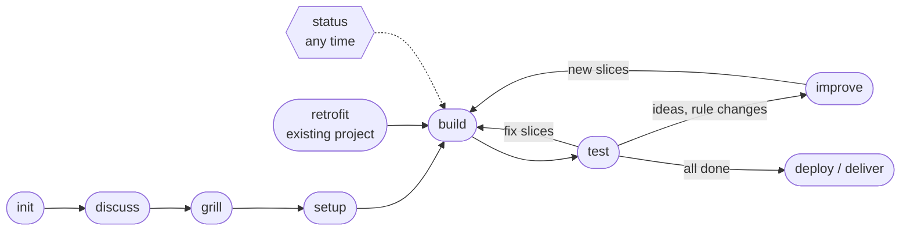

# stareso workflow

> Steps, helper roles and shared material to take a piece of work (a small web app, a data analysis, a game) from the first discussion to the delivered result, in small checked slices.
> A strong model decides, cheap fresh helpers build, records are generated and kept short.

📘 [`stareso/START-HERE.md`](stareso/START-HERE.md) for newcomers  ·  📖 [`stareso/README.md`](stareso/README.md) the manual  ·  📝 [`stareso/CHANGELOG.md`](stareso/CHANGELOG.md)

The steps are harness-neutral Agent Skills, and the Claude Code skills and agents are generated from them.
This repository is rooted at `~/.claude`, and its `.gitignore` is a whitelist: only the workflow is tracked, never credentials, settings, sessions, projects or memory.

---

## 🗺 The workflow

| Step | Model · session · mode | What it does |
|---|---|---|
| `stareso-init` ⌨ | strong · new · normal | A project from a pack: folders, private guard, git, first docs |
| `stareso-discuss` | strong · same · normal | Free talk, keeps `docs/IDEAS.md` |
| `stareso-grill` | strong · same · normal | Decision rounds with recommended answers, then `PLAN.md`, glossary and decisions |
| `stareso-setup` | strong · same · normal | Project instructions and the roadmap of small slices |
| `stareso-build` ⌨ | standard · new, no worktree · auto | One fresh helper per slice, checked and merged, profiles eco, fast, night, day |
| `stareso-test` | standard · new · normal | You test, feedback becomes fix slices or ideas |
| `stareso-improve` | strong · new · normal | New ideas into PLAN and new slices |
| `stareso-status` | any | 3 to 6 short lines: where it stands and the exact next step |
| `stareso-deploy` ⌨ | strong · new · normal | Pre-flight and the pack's steps to go online or deliver |
| `stareso-retrofit` ⌨ | strong · new · normal | An existing project into the workflow, behaviour kept |
| `stareso-retro` | quick: standard · deep: strong | Measured review of the workflow on a project |

⌨ = started only by typing it.
In Claude Code, the **stareso panel** (plugin `stareso-status`) shows the progress, the helpers, the chats and the usage beside the chat, with no model call.

---

## 📂 What is where

| Path | What |
|---|---|
| `stareso/skills/stareso-*/SKILL.md` | the steps, harness-neutral |
| `stareso/roles/` | helper roles: `slice-builder`, `slice-checker` |
| `stareso/capabilities/` | what a harness must provide, each with its manual fallback |
| `stareso/harness/<harness>/` | how each harness provides it: `claude-code` (adopted, with the panel plugin), `codex`, `cursor`, `gemini`, `chat-only` |
| `stareso/packs/<pack>/` | stack and conventions: `app-next`, `analysis-r`, `godot-game` |
| `stareso/tools/` | plain Node scripts: `slice-done`, `progress-graph`, `docs-check`, `usage-report`, `dashboard`, `session-stats`, `harness-build`, … |
| `stareso/templates/` | starting docs for a new project |
| `stareso/grilling.md`, `stareso/metrics.md` | how decisions are asked, how the workflow is measured |
| `stareso/DESIGN-NOTES.md`, `stareso/CHANGELOG.md` | why, and what changed |
| `skills/stareso-*/`, `agents/stareso-slice-*.md` | Claude Code's generated copies: edit the core, not these |

---

## 🛠 Saving a change

1. Edit the core in `stareso/`.
2. `node ~/.claude/stareso/tools/harness-build.mjs`
3. A dated line in `stareso/CHANGELOG.md`, then commit and push.
