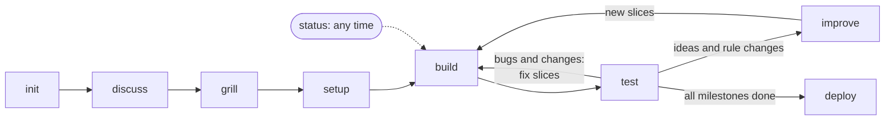

# stareso-app workflow

Claude Code skills and shared material used to build STARESO's small web apps (Scriba, SecuSurf, BaieWatch style): from a first discussion to a published app, in small checked slices.

This repository is rooted at `~/.claude`. Its `.gitignore` is a whitelist: only the workflow below is tracked; credentials, settings, sessions, projects and memory never are.

| Path | What |
|---|---|
| `skills/stareso-app-*/` | The skills: init, discuss, grill, setup, build, test, improve, status, deploy |
| `agents/stareso-slice-builder.md` | Helper agent that builds one roadmap slice |
| `stareso-app/README.md` | Manual: phases, which skill when, which model |
| `stareso-app/guide.md` | Stack and patterns shared by the apps |
| `stareso-app/grilling.md` | How decisions are asked and recorded |
| `stareso-app/templates/` | Starting docs for a new project |
| `stareso-app/CHANGELOG.md` | One line per workflow change |

## Workflow

Docs flow the same way: `IDEAS.md` (inbox) → `PLAN.md` (decided) → `ROADMAP.md` (slices) → code; test feedback goes to `FEEDBACK.md`.

## Skills, in the order of a project

| Skill | Model | What it does |
|---|---|---|
| `stareso-app-init` | Opus | Creates the project: folders, private guard, git, first docs |
| `stareso-app-discuss` | Opus | Free talk about the app; keeps `docs/IDEAS.md` |
| `stareso-app-grill` | Opus | Decision rounds with recommended answers; writes `PLAN.md`, `GLOSSARY.md`, decision records |
| `stareso-app-setup` | Opus | Writes `CLAUDE.md` and the roadmap of small slices in milestones |
| `stareso-app-build` | Sonnet, auto mode | Builds slices with one helper agent each, checks and merges them |
| `stareso-app-test` | Sonnet | Test in the browser pane; feedback becomes fix slices or ideas |
| `stareso-app-improve` | Opus | Turns new ideas or decisions into PLAN updates and new slices; keeps all docs coherent |
| `stareso-app-status` | any | Where the project stands and the next step |
| `stareso-app-deploy` | Opus | Publishing: GitHub, Supabase, Vercel, subdomain, phones |

`init`, `build` and `deploy` are started only by typing them; the others also by asking.

Start with `stareso-app/README.md`. To save a change: `git -C ~/.claude add -A`, commit, push.
