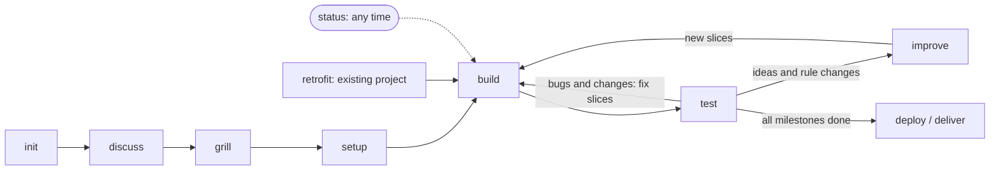

# stareso workflow

Claude Code skills, helper agents and shared material used at STARESO to take a piece of work (a small web app, a data analysis) from the first discussion to the delivered result, in small checked slices: the expensive model decides, cheap fresh helpers execute, records are generated and kept short.

This repository is rooted at `~/.claude`. Its `.gitignore` is a whitelist: only the workflow below is tracked; credentials, settings, sessions, projects and memory never are.

| Path | What |
|---|---|
| `skills/stareso-*/` | The skills: init, discuss, grill, setup, build, test, improve, status, deploy, retrofit |
| `agents/stareso-slice-builder.md`, `agents/stareso-slice-checker.md` | Helper agents: build one slice; check one milestone's outputs |
| `stareso/README.md` | Manual: phases, which skill when, which model and session, profiles |
| `stareso/grilling.md` | How decisions are asked and recorded |
| `stareso/templates/` | Starting docs for a new project (pack-independent) |
| `stareso/packs/<pack>/` | Stack and conventions: `app-next` (Next.js · Supabase · Vercel), `analysis-r` (R · figures · Quarto report) |
| `stareso/tools/` | Node scripts: `slice-done`, `docs-check`, `roadmap-overview`, `roadmap-split`, `session-stats` |
| `stareso/DESIGN-NOTES.md`, `stareso/CHANGELOG.md`, `stareso/PORTABILITY.md` | Why, what changed, how to use it with another assistant |

## Workflow

Docs flow the same way: `IDEAS.md` (inbox) → `PLAN.md` (decided) → `ROADMAP.md` + `roadmap/<ID>.md` (slices) → code; test feedback goes to `FEEDBACK.md`; the build log and the overview are generated.

## Skills, in the order of a project

| Skill | Model · session · mode | What it does |
|---|---|---|
| `stareso-init` | Opus · new · normal | Creates the project from a pack: folders, private guard, git, first docs, the workflow chart |
| `stareso-discuss` | Opus · same · normal | Free talk; keeps `docs/IDEAS.md` |
| `stareso-grill` | Opus · same · normal | Decision rounds with recommended answers, access table, modes, walkthrough; writes `PLAN.md`, `GLOSSARY.md`, decisions |
| `stareso-setup` | Opus · same · normal | `CLAUDE.md` with the Commands table and the roadmap (overview + one file per milestone) |
| `stareso-build` | Sonnet · new, no worktree · auto | Conductor: one helper per slice, `check`, `slice-done`; checker helper and tidy slice per milestone; eco or fast profile |
| `stareso-test` | Sonnet · new · normal | Test in the browser pane or on the rendered report; feedback becomes fix slices or ideas |
| `stareso-improve` | Opus · new · normal | New ideas or decisions → PLAN updates and new slices; coherence check |
| `stareso-status` | any | Where the project stands, debt, and the next step with its model and session |
| `stareso-deploy` | Opus · new · normal | Pre-flight and the pack's steps for going online or delivering |
| `stareso-retrofit` | Opus · new · normal | Brings an existing project into the workflow without rewriting it |

`init`, `build`, `deploy` and `retrofit` are started only by typing them; the others also by asking.

Start with `stareso/README.md`. To save a change: `git -C ~/.claude add -A`, commit, push.
