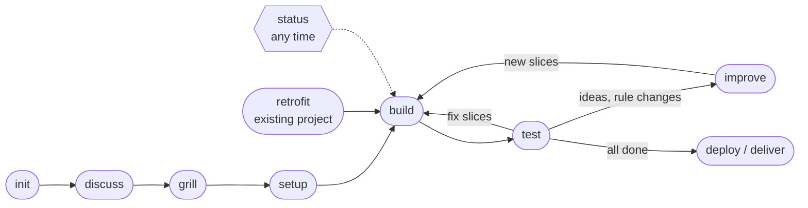
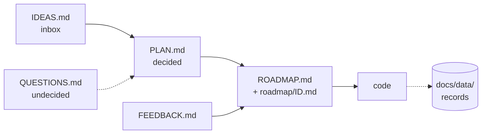

# stareso workflow

> From first idea to delivered result, in small checked slices.
> A strong model decides, cheap fresh helpers build, and every decision is written down.

📘 New to AI assistants? → [`START-HERE.md`](START-HERE.md)  ·  🧭 Why it works this way → [`DESIGN-NOTES.md`](DESIGN-NOTES.md)  ·  📝 What changed → [`CHANGELOG.md`](CHANGELOG.md)  ·  🔌 Another assistant → [`harness/README.md`](harness/README.md)

The method was born with three small web apps and does not depend on the kind of work or on the assistant.
A **pack** carries what is specific to the work (stack, conventions, checks, delivery).
A **harness** carries what is specific to the assistant (helpers, read guard, hooks, models).

---

## 🗺 At a glance



| Symbol | Means |
|:---:|---|
| ▶ | the next step, or a helper at work |
| ■ | done |
| □ | waiting |
| ⚠ | a blocker or a usage cap in sight |
| ↗ | the stareso panel |
| 💭 | an idea not yet planned |

**Three words.**
A **step** is one phase (init, grill, build…), written as one `SKILL.md`.
A **tier** is the class of model a step or slice needs: **strong**, **standard** or **light** (Claude Code: Opus, Sonnet, Haiku).
The **project instructions** file is `AGENTS.md`, which Claude Code calls `CLAUDE.md`.

---

## 🪜 The steps

| Step | Start it with | Model · session · mode | What it does |
|---|---|---|---|
| `init` | `/stareso-init <name> [pack]` ⌨ | strong · new · normal | Folders from the pack, private guard and its canary, git, next-steps chart |
| `discuss` | "let's discuss" | strong · same or new · normal | Free talk (keyboard or voice), approved sources, keeps `IDEAS.md` |
| `grill` | "let's grill" | strong · same · normal | Numbered rounds with recommended answers, writes `PLAN.md`, `GLOSSARY.md` and decisions, ends with a walkthrough |
| `setup` | `/stareso-setup` | strong · same · normal | Short project instructions with the Commands table, roadmap of small slices |
| `build` | `/stareso-build M1 [eco\|fast]` ⌨ | **standard · new, no worktree · auto** | Conductor: one fresh helper per slice, `check`, `slice-done`, a checker and a tidy slice per milestone |
| `test` | "test time" | standard · new · normal | What is new, your feedback logged, turned into fix slices at "end test" |
| `improve` | "I have a new idea" | strong · new · normal | One idea, discussed and grilled, into PLAN and a new milestone |
| `status` | "where are we?" | any | 3 to 6 short lines and the exact next step (below) |
| `deploy` | `/stareso-deploy` ⌨ | strong · new · normal | Pre-flight, `DEPLOY.md`, the pack's steps one at a time |
| `retrofit` | `/stareso-retrofit [pack]` ⌨ | strong · new · normal | An existing project into the workflow, behaviour kept |
| `retro` | `/stareso-retro [quick\|deep]` | quick: standard · deep: strong | Measured review from the records, at most three workflow changes |

⌨ = typed only. The assistant never starts these on its own, because they create things, spend tokens or go online.
Every step opens with its **Session** line and closes with the next step's.

### ▶ Status, in one look

`/stareso-status` answers in one model turn. The tool `progress-graph.mjs --status` reads the records and git in half a second, applies the rule table and prints the answer:

```text
proj · build M11 7/13 · fast · ends ≈ 21:18
⚠ 5-hour 53 %: helper-start cap 85 % ≈ 23:18
⚠ weekly 82 %: cap 95 % ≈ 03:57 tomorrow
□ 9 human slices, 12 questions wait on you
▶ after M11: /stareso-test (sonnet, new session)
↗ panel: ◆ stareso-status or /stareso-panel
```

Everything else lives in the **stareso panel** beside the chat (Claude Code): milestones and their times, the slice grid with a card per slice, helpers, chats, pace, plan windows and seven usage charts. Details: [`harness/claude-code/README.md`](harness/claude-code/README.md).

Usage has no step of its own. The panel shows it live, the retro reads it, and [`metrics.md`](metrics.md) ("The usage report") explains every number.

---

## ⚙ Build profiles

| Profile | Helpers | When |
|---|---|---|
| **eco** (default) | one at a time, in the project folder, one checker per milestone | you are away and not in a hurry: the cheapest |
| **fast** | up to 3 in parallel on independent slices, each in its own worktree | you need it soon, and accept a higher cost |
| **night** `<limit>` | fast's helpers for a long unattended run, paced on the usage window, then the queue milestone `Q` | you sleep and want the window used (packs that allow it) |
| **day** `<limit>` | eco's loop with full autonomy, windows only when you are away | you work on the same computer (packs that allow it) |

The tier is chosen **per slice in its brief**, not by the profile.
A merged helper's worktree is removed by `slice-done`, so caches (a Godot import is about 800 MB) never pile up.

---

## 🔁 Your routine

1. **Start.** Empty folder, strong model: `/stareso-init <name> app-next`. An existing project: `/stareso-retrofit`.
2. **Sources.** Reference files go to `private/sources/locked/`. The assistant asks before reading any of them.
3. **Decide.** Talk, then say **"let's grill"** and answer the rounds ("1 yes, 2 no, rather…").
4. **Plan.** `/stareso-setup`, then review the milestones and slice titles.
5. **Build.** New session, standard model, auto mode, project folder: `/stareso-build M1`. Leave it. What you notice goes to FEEDBACK.
6. **Test.** New session, "test time", click around, "end test".
7. **Loop.** Fixes: `/stareso-build M<n>`. New ideas: `/stareso-improve`. Back after a break: `/stareso-status`.
8. **Ship.** `/stareso-deploy`. Later feedback from phones or readers: `/stareso-test`.

---

## 📂 Files in each project



Nothing lives only in the chat.
`FEEDBACK.md` feeds the next milestone, `QUESTIONS.md` holds what nobody could decide yet, and `docs/data/` records what was done and what it cost (one event per line, read by the tools, never by hand).
A step that touches a decision runs `roadmap-overview` and `docs-check` before committing, because tools check structure, not meaning.

<details>
<summary><b>Every file: when it enters, who writes and reads it</b></summary>

| File | Enters at | Written by | Read by | Kept coherent by | Leaves |
|---|---|---|---|---|---|
| guard file (Claude Code: `.claude/settings.json`), `.gitattributes`, `.editorconfig` | init, retrofit | init, retrofit | the harness, git | the canary (`Guard:` line in PLAN) | never |
| `AGENTS.md` (Claude Code: `CLAUDE.md`) | init, **setup** | setup, improve, retrofit, deploy | every session and helper | improve's old-wording search, `docs-check` | never, stays short |
| `private/sources/INDEX.md` | init | init, discuss | discuss, grill | — | never |
| `docs/PLAN.md` | init | grill, improve, retrofit, deploy | setup, build, improve, status, checker | improve's coherence step, the walkthrough, `docs-check` | never: single source of truth |
| `docs/IDEAS.md` | init | discuss, test (💭), improve (💭 → 🛠 / ✖), retrofit | discuss, grill, improve, status | `slice-done` (🛠 → ✅), `docs-check` | lines change status, never deleted |
| `docs/GLOSSARY.md` | init | grill, improve, retrofit | discuss, setup, helpers | improve's old-wording search | never |
| `docs/decisions/` | grill | grill, improve, retrofit | improve, anyone asking "why" | a replaced record says so | never |
| `docs/ROADMAP.md` | **setup** | tools only | status, build, improve, test, you | generated | never |
| `docs/roadmap/<ID>.md` | setup, test, improve | setup, test, improve, retrofit, `slice-done` | build, helpers, checker | `docs-check` | stays |
| `docs/QUESTIONS.md` | **setup** | build, test, retrofit, tidy slices, answered by improve | **improve first**, build, status | `docs-check` | ticked with their answer |
| `docs/FEEDBACK.md` | setup | test, build (requests during a run) | test's "end test", improve | `docs-check` | older blocks → `FEEDBACK-DONE.md` |
| `docs/data/builds.jsonl` | setup | `slice-done`, `record.mjs` | status, panel, retro | `docs-check` | never: append only |
| `docs/data/sessions.jsonl` | setup | `session-stats --log` | panel, retro | — | never: append only |
| `docs/RETROS.md` | setup | retro | retro, status | — | never |
| `docs/reports/` | on request | `usage-report.mjs --all` (a dated Markdown file) | you | — | never |
| `docs/LOGBOOK.md` (analysis) | init | slices, you | report writing, improve | — | never |
| `docs/DEPLOY.md` (app) | **deploy** | deploy | deploy, you | lessons copied to the pack | never |
| `docs/README.md` | init | any step that adds a doc | newcomers | `docs-check` | never |
| `private/`, `data/raw`, `data/processed`, `outputs/` | init | you, import scripts | nobody reads rows | read guard | never committed |

</details>

---

## 🧰 Tools

Plain Node in `stareso/tools/`, no install. The everyday ones:

- `slice-done.mjs <id>` merges a slice, ticks it, logs it, removes its helper's worktree and commits.
- `progress-graph.mjs --status | --panel | --brief | --write` gives the build's state from the records and git.
- `docs-check.mjs` checks that the records agree with each other.
- `usage-report.mjs` gives the usage report (tables, `--json`, `--charts`, `--live`).

<details>
<summary><b>Every tool and its options</b></summary>

| Tool | Use |
|---|---|
| `slice-done.mjs <id> --model m --tokens n --note "…"` | merges the slice branch `--no-ff`, ticks the box, flips 🛠 → ✅ in IDEAS, appends the build event (merge time and lines, the helper's measured usage), removes the helper's worktree when it holds no uncommitted work, regenerates the overview and commits. `--keep-worktree` keeps it |
| `docs-check.mjs` | coherence of the records: ticked slice without a record, stale 🛠, broken `after:`, missing `Pack:`, docs not listed, old files, no `docs/data/` yet |
| `roadmap-overview.mjs` | regenerates the overview of `ROADMAP.md` |
| `roadmap-split.mjs` | one-off: splits an old single-file roadmap into the folder layout |
| `progress-graph.mjs` | `--status` the answer of status, `--panel` the panel's data, `--brief` the sections, `--write` an SVG and a page for a harness with no panel. Never writes in the project |
| `session-stats.mjs --log` | reads the Claude Code transcripts and appends every session that changed to `docs/data/sessions.jsonl`. `--print` shows the usage tables, `--prune` lists old conversation logs (`--yes` deletes them) |
| `usage-report.mjs` | the usage report from the records: six tables, `--json`, `--summary`, `--builds`, `--projects`, `--charts`, `--panel`, `--live` |
| `record.mjs caps … \| note "…"` | appends a caps or note event to the build records |
| `migrate-records.mjs` | one shot per project: older record files into `docs/data/`. Setup runs it in a new project, and the other tools ask for it when `docs/data/` is missing |
| `usage-seed.mjs <rev> <n>` | brings an archived session back from an older usage table kept in git |
| `workflow-usage.mjs` | what keeping the workflow itself costs (chats run in `~/.claude`) |
| `harness-build.mjs [--check]` | generates the Claude Code skills and agents from the core, `--check` exits 1 on drift |
| `session-stats.mjs <out> <transcripts…>` | deep retro: each transcript's header and its user-message timeline |
| `workflow-changed.mjs` | Claude Code hook: tells a running session that the workflow changed, so it re-reads its step. Install once per machine from `harness/claude-code/extras/settings.hooks.json` |

</details>

---

## 📈 The progress graph and the ETAs

`progress-graph.mjs` reads the roadmap, QUESTIONS, PLAN, IDEAS, the build records and `git worktree list`, never the code, in well under a second.

- ■ **Lanes.** One row per milestone with open slices, each slice coloured by state: done, running, could start, waits on you, waiting.
- ▶ **Running.** A helper is a branch `slice/<id>-…` whose slice is still open.
- ⏱ **Pace.** The time of one slice is the median gap between serial merges. The ETA is the larger of "slices shared among the helpers" and "the longest chain".
- 🎯 **ETA learning.** Each running helper's prediction is kept once, compared with its merge, and the median miss of the last 20 slices corrects the next ETAs. The panel's chart 7 draws it.
- ⚠ **Usage and caps.** The tool keeps the plan's readings per machine, works out the burn rate, and says when each stop cap is reached, one line per window.

<details>
<summary><b>How each part is computed</b></summary>

- **Lanes.** Lettered milestones (`H`, `P`, `Q`) are one block each. Finished milestones fold into one line. `--max-lanes` (default 8) caps the lanes.
- **Ready, human, questions.** `ready` holds the open slices whose `after:` slices are done, that no helper runs and no question blocks. A tidy slice waits for the rest of its milestone.
- **Pace.** Gaps over 90 minutes are left out. Without serial merges, the recent gap between merges stands in, undivided, since it already holds that run's parallelism.
- **ETA per slice and per milestone.** A small simulation plays the rest of the build with the helpers running now (or the profile's usual count when idle). A slice that waits on you, and what waits on it, gets no time. Shared files, pauses at the caps and the checker are not modelled, so the times are a floor more than a promise, which the learned factor then corrects.
- **ETA learning.** Predictions live in `stareso/data/eta/<project>.jsonl` on this machine, never in the project. The factor is the median of actual ÷ predicted over the last 20 merged slices (at least 4), clamped to 0.5–3 and measured against the raw estimate, so it never compounds.
- **Usage and caps.** Readings live in `stareso/data/plan-windows.jsonl`. The burn rate comes from the oldest reading of the same window in the last three hours. Caps come from the newest caps event of the build records (`record.mjs caps --start 85 --pause 90 --weekly 95`) or from `--caps`.
- **Live panel.** The `stareso-status` plugin shows all of this beside the chat and refreshes it every minute without a model call.

</details>

---

## 📦 Packs

A pack is a folder `packs/<name>/` with `README.md`, `guide.md` (numbered sections), `templates/` and, for things that go online or get delivered, `deploy.md`. `PLAN.md` names the pack, and each step reads only the sections it needs.

| Pack | For |
|---|---|
| `app-next` | small team web app: Next.js, Postgres (Supabase), Vercel, PWA, browser-pane checks |
| `analysis-r` | data analysis in R: modules, steps, tests and regression snapshot, figures, Quarto report |
| `godot-game` | 2D game in Godot 4 for PC and tablets: data-driven entities, off-screen runs, playtests, release steps |

A new kind of work gets its pack from its first real project: copy the closest pack, keep the section layout, change the content. The steps do not change.

---

## 🔒 Privacy

- Everything in `private/` and the data folders stays private. Reading a file sends it to the model, so the assistant reads only what you approved.
- Datasets are seen as structure only, through a script you agree to run. Development uses toy samples.
- Where the harness can enforce it (Claude Code: deny rules), init installs the guard and checks it with a canary file. In a chat window, never upload a private file.

**This repository stays free of private information**, since it may be shared: no user names or home paths (write `<you>`), no e-mail addresses, domains, keys, account ids, real people or data. Project facts live in each project's own repository.

---

## 🪶 Keeping it light

- **One step per session.** The files are the memory, not the chat. `/clear` and `/stareso-status` beat a compaction.
- **The conductor sees reports and failures only.** Helpers are fresh and read only their brief.
- **Human input is batched** in test rounds, never streamed into a running build.
- **Records are generated** by the tools, in one format. A tidy slice closes every milestone.

---

## 🛠 Changing the workflow

1. Edit the core: the step in `skills/`, the role in `roles/`, a pack or a template, in harness-neutral wording.
2. Run `node ~/.claude/stareso/tools/harness-build.mjs` and check that `--check` passes.
3. Add a dated line to `CHANGELOG.md`: what changed, and why.
4. Commit in `~/.claude` and push to the `stareso-workflow` remote.

The retro proposes changes and you accept them one by one. Measure before and after, as [`metrics.md`](metrics.md) says.

<details>
<summary><b>Where everything lives</b></summary>

| What | Where |
|---|---|
| The steps, harness-neutral | `stareso/skills/stareso-*/SKILL.md` |
| The helper roles | `stareso/roles/slice-builder.md`, `slice-checker.md` |
| What a harness must provide | `stareso/capabilities/` |
| How each harness provides it | `stareso/harness/<harness>/` |
| Shared material: this manual, grilling, metrics, templates, tools | `stareso/` |
| Packs | `stareso/packs/<pack>/` |
| Claude Code's generated copies | `~/.claude/skills/stareso-*/`, `~/.claude/agents/stareso-slice-*.md` |
| Per-machine data (plan readings, ETA learning, caches), never committed | `stareso/data/` |

The steps write `<stareso>` for the `stareso/` folder. In Claude Code it sits in `~/.claude`, which is the git repository, and its whitelist `.gitignore` tracks only the workflow.

</details>
