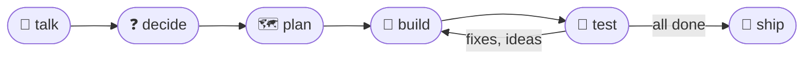

# 📘 Start here

> For someone who has never worked with an AI coding assistant.
> Five minutes, then you can start a project.

---

## What this is

The stareso workflow is a way to build a small web app, a data analysis or a game with an AI assistant, **in small checked pieces**.
You decide, the assistant writes, and everything decided is written down in the project's `docs/` folder, so nothing depends on the chat.

The method is split into **steps**. Each step is one instruction file (`skills/<step>/SKILL.md`), and your assistant runs it when you ask.

---

## The five words you need

| | Word | Meaning |
|:---:|---|---|
| 🔌 | **Harness** | the program you talk to: Claude Code, Codex, Cursor, Gemini CLI, or a chat window. `harness/<name>/README.md` says how to set it up. |
| 🎚 | **Tier** | how capable a model a step needs: **strong** for decisions, **standard** for most work, **light** for trivial edits. |
| 🍰 | **Slice** | one small piece of work (a screen, a figure family) that is built and checked on its own. The roadmap is a list of slices. |
| 🤝 | **Helper** | a fresh assistant that builds one slice from its written brief, so the main session stays small and cheap. |
| 🔒 | **Read guard** | the rule that private files (`private/`, raw data, `.env`) are never read, since reading a file sends it to the model. |

---

## Your first project

1. 📁 **Make an empty folder** and open your harness there, on a **strong** model.
2. ✨ **Start** with `/stareso-init my-app app-next`. It creates the folders and the private guard, then checks the guard with a harmless test file.
3. 🔒 **Put your reference material** (forms, exports, notes) in `private/sources/locked/`. The assistant asks before reading anything.
4. 💬 **Talk** about the project. When you are ready, say **"let's grill"**: numbered questions come, each with a recommended answer, and you reply "1 yes, 2 no, rather …".
5. 🗺 **`/stareso-setup`** writes the rules and the roadmap.
6. 🔨 **Open a new session** on a **standard** model and type `/stareso-build M1`. Let it work.
7. 🧪 **When it reports**, open a new session and say **"test time"**. Click around, say what you see, then "end test".

▶ Lost at any point? `/stareso-status` tells you where you are and the exact next step, in a few lines.

---

## Three habits that keep it cheap

- 🪶 **One step per session.** A long chat is re-read at every turn, so a new session costs less than a long one.
- 📥 **Requests during a build go to feedback**, not into the build. The next test round turns them into slices.
- 🔒 **Never paste or upload private files**, whatever the harness.

---

Next: [`README.md`](README.md) (the full manual), `harness/<your harness>/README.md`, and [`grilling.md`](grilling.md) to see how decisions are asked.
